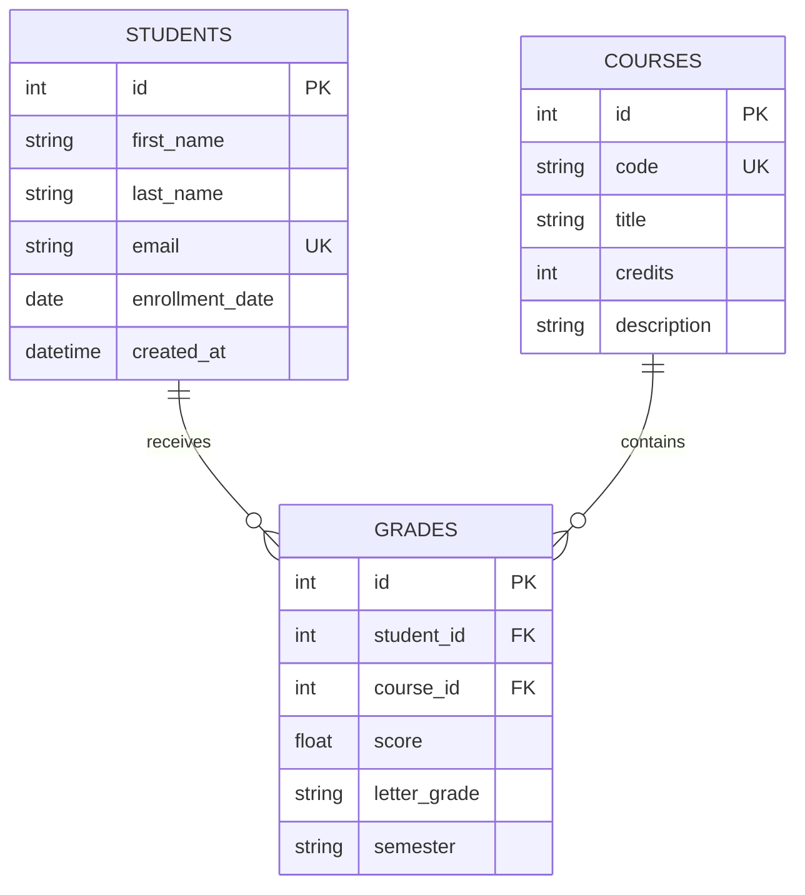

# Student Grade Management API

[](https://www.python.org/)
[](https://fastapi.tiangolo.com/)
[](#license)

A modular, production-oriented REST API for managing students, courses, grades, and academic analytics. The service is built with FastAPI, SQLAlchemy 2, Pydantic v2, SQLite, Uvicorn, and Pytest.

## Features

The API provides versioned REST endpoints under `/api/v1`. It supports complete student, course, and grade workflows, including pagination, student-name search, filtering by student or course, duplicate protection, database-level constraints, automatic letter-grade calculation, cascade deletion, and credit-weighted GPA analytics. FastAPI also exposes interactive OpenAPI documentation at `/docs` and a ReDoc view at `/redoc`.

All request data is validated with Pydantic v2. Email addresses, course credits, names, semester values, and score boundaries are validated before business logic runs. Application errors use a consistent JSON envelope such as:

```json
{
  "success": false,
  "error": {
    "code": "STUDENT_NOT_FOUND",
    "message": "Student 42 was not found"
  }
}
```

## Architecture

The repository separates HTTP routing, configuration, persistence, ORM models, validation schemas, and business logic. This design keeps endpoint functions thin and makes core behavior straightforward to test in isolation.

| Layer | Responsibility |
|---|---|
| `app/api/v1/endpoints` | HTTP routes, query parameters, dependency injection, and response models |
| `app/services` | Business rules, analytics, conflict handling, and persistence orchestration |
| `app/models` | SQLAlchemy ORM entities and database constraints |
| `app/schemas` | Pydantic v2 input validation and response serialization |
| `app/core` | Settings, database engine/session lifecycle, and application exceptions |
| `tests` | Isolated API tests using an in-memory SQLite database |

### Database ER Diagram



## Project Structure

```text
student_grade_api/
├── app/
│   ├── api/
│   │   └── v1/
│   │       ├── endpoints/
│   │       │   ├── analytics.py
│   │       │   ├── courses.py
│   │       │   ├── grades.py
│   │       │   └── students.py
│   │       └── router.py
│   ├── core/
│   │   ├── config.py
│   │   ├── database.py
│   │   └── errors.py
│   ├── models/
│   ├── schemas/
│   ├── services/
│   └── main.py
├── tests/
│   ├── conftest.py
│   ├── test_analytics.py
│   ├── test_grades.py
│   └── test_students.py
├── .env.example
├── .gitignore
├── requirements.txt
└── README.md
```

## API Endpoints

| Resource | Available operations |
|---|---|
| Students | Create, list with pagination and name search, detail with courses and GPA, update, delete |
| Courses | Create, list with pagination, retrieve, update, delete |
| Grades | Submit, list with student/course filters, retrieve, update score, delete |
| Analytics | Student GPA and weighted average; course mean, maximum, minimum, and passing rate |

Letter grades are computed using the following score bands: `A` for 90–100, `B` for 80–89.99, `C` for 70–79.99, `D` for 60–69.99, and `F` below 60. GPA uses the corresponding 4.0, 3.0, 2.0, 1.0, and 0.0 grade points weighted by course credits.

## Local Setup

The project targets Python 3.11 or newer. Create a virtual environment, install dependencies, copy the environment template, and start the development server:

```bash
git clone <your-repository-url>
cd student_grade_api
python3 -m venv .venv
source .venv/bin/activate
pip install --upgrade pip
pip install -r requirements.txt
cp .env.example .env
uvicorn app.main:app --reload
```

The service is then available at `http://127.0.0.1:8000`. Interactive Swagger documentation is available at [http://127.0.0.1:8000/docs](http://127.0.0.1:8000/docs), and the OpenAPI specification is available at [http://127.0.0.1:8000/openapi.json](http://127.0.0.1:8000/openapi.json).

## Running Tests

Tests create an isolated in-memory SQLite database for each test, so they do not modify the local development database:

```bash
pytest -q
```

## Example Requests

Create a student:

```bash
curl -X POST http://127.0.0.1:8000/api/v1/students/ \
  -H "Content-Type: application/json" \
  -d '{
    "first_name": "Ada",
    "last_name": "Lovelace",
    "email": "ada@example.com",
    "enrollment_date": "2026-09-01"
  }'
```

Create a course:

```bash
curl -X POST http://127.0.0.1:8000/api/v1/courses/ \
  -H "Content-Type: application/json" \
  -d '{
    "code": "CS101",
    "title": "Introduction to Computer Science",
    "credits": 4,
    "description": "Foundational computing concepts"
  }'
```

Submit a grade, replacing the IDs with values returned by the create requests:

```bash
curl -X POST http://127.0.0.1:8000/api/v1/grades/ \
  -H "Content-Type: application/json" \
  -d '{
    "student_id": 1,
    "course_id": 1,
    "score": 94.5,
    "semester": "Fall 2026"
  }'
```

List students with pagination and search:

```bash
curl "http://127.0.0.1:8000/api/v1/students/?limit=20&offset=0&search=Ada"
```

Retrieve a student's GPA summary:

```bash
curl http://127.0.0.1:8000/api/v1/analytics/students/1/gpa
```

Retrieve course statistics:

```bash
curl http://127.0.0.1:8000/api/v1/analytics/courses/1/stats
```

## Configuration

Configuration is loaded from environment variables and an optional `.env` file. The most relevant settings are:

| Variable | Default | Description |
|---|---|---|
| `DATABASE_URL` | `sqlite:///./student_grades.db` | SQLAlchemy database URL |
| `APP_NAME` | `Student Grade Management API` | OpenAPI application title |
| `APP_VERSION` | `1.0.0` | API version displayed in OpenAPI |
| `ENVIRONMENT` | `development` | Deployment environment label |
| `DEBUG` | `false` | Debug configuration flag |
| `CORS_ORIGINS` | `*` | Comma-separated allowed origins |

## Production Notes

For production deployments, use a managed database or a durable database volume instead of an ephemeral local SQLite file. Place the application behind a process manager or container orchestration platform, restrict `CORS_ORIGINS` to trusted origins, and add authentication and authorization before exposing student records to untrusted clients. Database schema changes should be managed with a migration tool such as Alembic rather than relying on `create_all`.

## License

This project is released under the MIT License. Add the full license text to a `LICENSE` file before publishing the repository.

## References

[1]: https://fastapi.tiangolo.com/ "FastAPI documentation"
[2]: https://docs.sqlalchemy.org/en/20/ "SQLAlchemy 2.0 documentation"
[3]: https://docs.pydantic.dev/latest/ "Pydantic documentation"
[4]: https://docs.pytest.org/en/stable/ "Pytest documentation"
